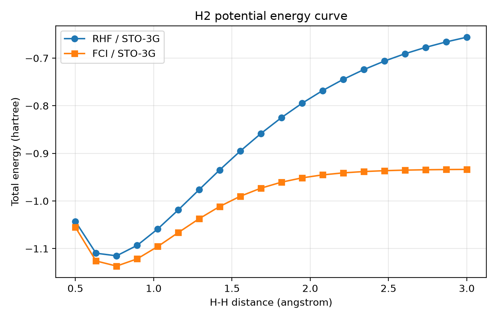
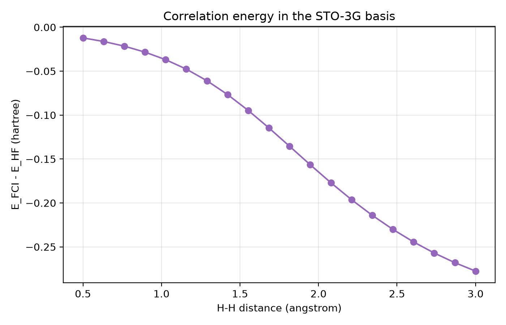
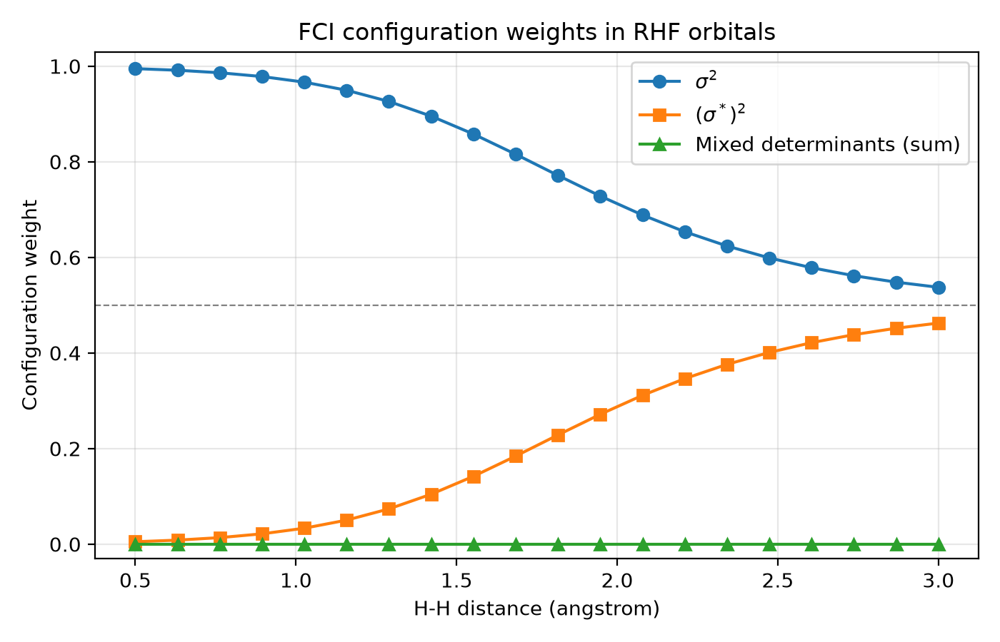
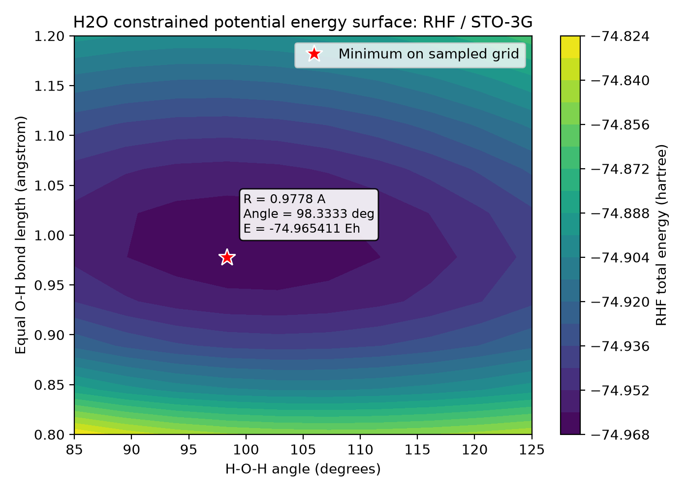
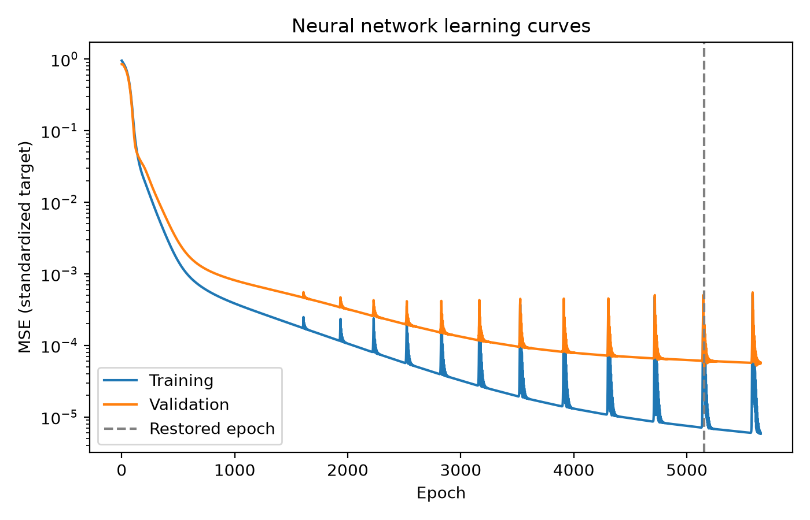
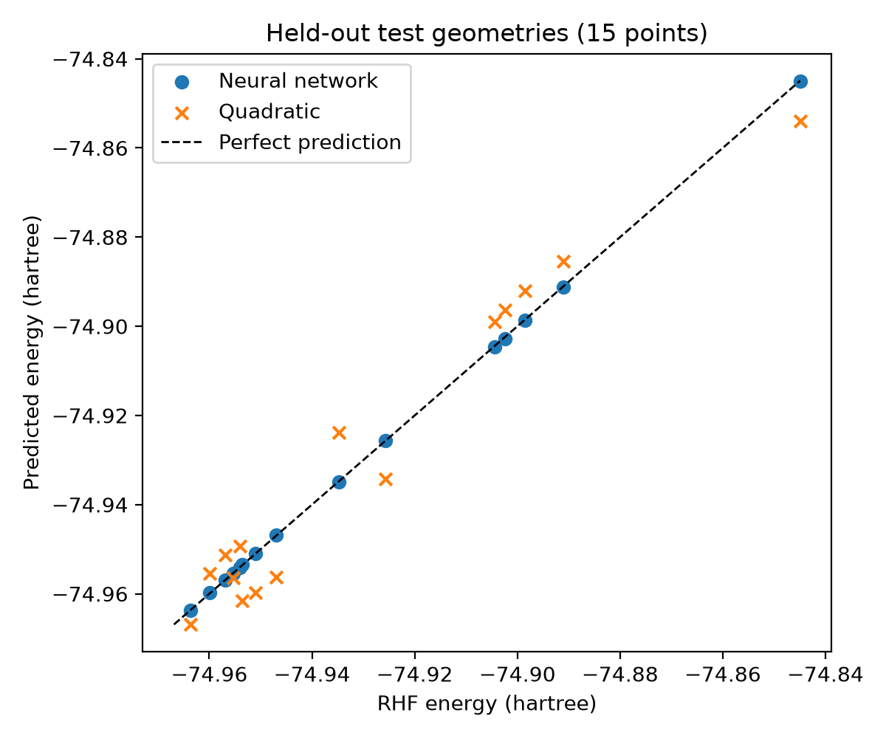

# Quantum Chemistry and Neural Network Potential Energy Surfaces

A small computational chemistry project connecting electronic structure calculations with supervised learning.

Two studies are presented:

- **H₂:** comparison of restricted Hartree–Fock (RHF) and Full Configuration Interaction (FCI), including correlation energies and configuration weights.
- **H₂O:** calculation of a constrained RHF potential energy surface, followed by a comparison between a PyTorch neural network and quadratic regression.

All quantum calculations use PySCF and the STO-3G basis. Reported total energies include nuclear repulsion.

## H₂: Electronic Correlation and Bond Stretching

RHF and FCI energies were calculated at 20 H–H distances between 0.5 and 3.0 Å. All calculations converged.

| H–H distance (Å) | RHF energy (hartree) | FCI energy (hartree) | FCI − RHF (hartree) |
| --- | --- | --- | --- |
| 0.763158 | -1.1151049457 | -1.1366635354 | -0.0215585897 |
| 3.000000 | -0.6560482511 | -0.9336318446 | -0.2775835935 |

Both sampled energy minima occur at approximately 0.763158 Å. This is a grid minimum, not an optimized equilibrium geometry.





The FCI wavefunction was analyzed using squared CI coefficient magnitudes in the canonical RHF orbital basis. Normalization and both mixed-determinant contributions were checked.

| H–H distance (Å) | Bonding σ² weight | Antibonding (σ\*)² weight |
| --- | --- | --- |
| 0.763158 | 98.6240% | 1.3760% |
| 3.000000 | 53.7444% | 46.2556% |

The combined mixed-determinant weight remains below 4.49 × 10⁻²⁷, consistent with numerical roundoff.



Stretching the bond makes two configurations important. RHF cannot represent this static correlation with its single restricted determinant, even when SCF has converged. The configuration analysis is specific to H₂/STO-3G and the RHF orbitals used here; weights depend on the orbital basis and do not show relative phases. Further details are available in the [H₂ study report](h2/README.md).

## H₂O: Learning a Constrained Potential Energy Surface

**Question:** Can a neural network accurately approximate the constrained potential energy surface of H₂O from a limited set of quantum chemistry calculations?

A regular grid of 100 geometries covers equal O–H lengths from 0.8 to 1.2 Å and H–O–H angles from 85 to 125 degrees. All RHF calculations converged.

| Equal O–H length (Å) | H–O–H angle (degrees) | Minimum grid energy (hartree) |
| --- | --- | --- |
| 0.97777778 | 98.33333333 | -74.965411283842 |



A neural network with two 32-neuron hidden layers and Tanh activations was compared with degree-2 polynomial regression. Both models use the same 70 training geometries. Fifteen validation geometries select the network checkpoint, and 15 test geometries are reserved for final evaluation. The split uses seed 42.

Inputs and target energies are standardized using training statistics only. Errors are evaluated after converting predictions back to hartree.

| Model | Test MAE (hartree) | Test RMSE (hartree) | MAE (mEh) | RMSE (mEh) |
| --- | --- | --- | --- | --- |
| PyTorch neural network | 0.0001361662 | 0.0001580903 | 0.136166 | 0.158090 |
| Quadratic regression | 0.0064826161 | 0.0069594570 | 6.482616 | 6.959457 |

The test MAEs are approximately **0.136 mEh** and **6.483 mEh**, respectively. The network is more accurate on this single split, but this comparison does not demonstrate a general superiority of neural networks.

**The network approximates the constrained RHF/STO-3G surface. It does not predict experimental energies or H₂O FCI energies.**





An identical second run reproduced the saved predictions and metrics in the same environment. Further details are available in the [water study report](h2o/README.md).

## Limitations

STO-3G is a minimal basis. FCI is exact only within the chosen finite basis and electronic Hamiltonian; RHF omits electron correlation beyond Hartree–Fock.

The H₂O surface constrains both O–H lengths to remain equal and samples a limited range. Neither grid minimum is a continuous geometry optimization. Nuclear motion, zero-point energy, thermal effects and relativistic corrections are excluded.

The learning study uses one split with only 15 test geometries. It does not establish reliable extrapolation, transfer to other molecules or accurate forces. Learning the RHF surface does not remove its physical limitations.

## Installation and Reproduction

Use Python 3.14 on Linux or Ubuntu under WSL. From the repository root:

```bash
python3 -m venv .venv-wsl
source .venv-wsl/bin/activate
python -m pip install -r requirements.txt
python -m pip install -r h2o/requirements-ml.txt
python -m pip check
```

If the environment already exists, skip its creation.

Run each study separately:

```bash
# H₂ energies and configuration weights
python h2/main.py

# H₂O quantum chemistry dataset
python h2o/generate_data.py

# Machine learning comparison using the existing H₂O CSV
python h2o/train_model.py
```

The repository includes calculated outputs. Running these commands overwrites the corresponding result files. Training alone does not run PySCF.

The recorded environment used PySCF 2.14.0, NumPy 2.5.4, Matplotlib 3.11.2 and PyTorch 2.15.0+cpu. Exact numerical reproducibility across platforms is not guaranteed.

## Repository Layout

```text
README.md                       Overview of both studies
requirements.txt                Quantum chemistry dependencies
.gitignore                      Local environments, caches and temporary files
h2/
    main.py                     H₂ calculations and analysis
    results.csv                 H₂ energies and configuration weights
    README.md                   H₂ study report
    figures/                    Three H₂ figures
h2o/
    generate_data.py            H₂O RHF calculations
    train_model.py              Neural network and quadratic regression
    water_energies.csv           100 quantum chemistry geometries
    ml_metrics.json             Settings, split indices and test metrics
    test_predictions.csv        Predictions for the 15 test geometries
    training_history.csv        Training and validation losses
    README.md                   Detailed H₂O and learning report
    requirements-ml.txt         PyTorch CPU dependency
    figures/                    H₂O surface and learning figures
```

## References

- [PySCF documentation](https://pyscf.org/)
- [PySCF installation](https://pyscf.org/user/install.html)
- [PySCF FCI representation](https://pyscf.org/pyscf_api_docs/pyscf.fci.html)
- [PySCF FCI implementation](https://pyscf.org/_modules/pyscf/fci.html)
- [PyTorch reproducibility](https://docs.pytorch.org/docs/stable/notes/randomness.html)
