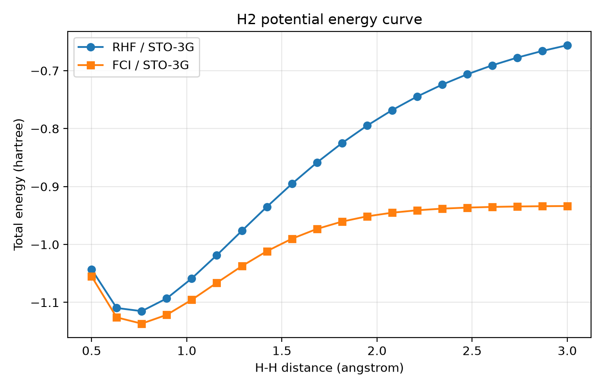
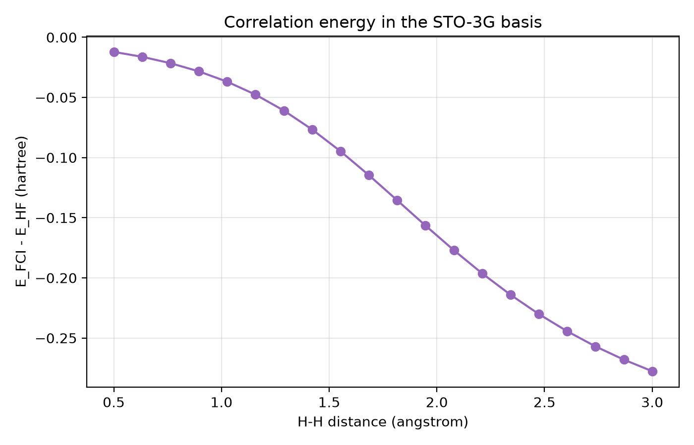
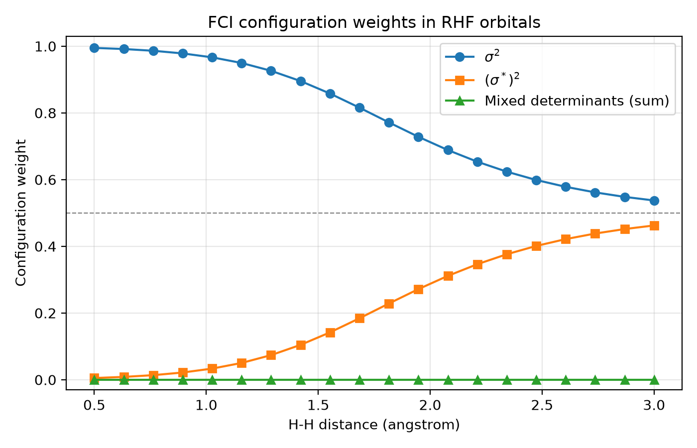

# H₂ Potential Energy Curve — RHF vs FCI

## Aim and Methods

This study examines electron correlation during H₂ bond stretching using PySCF and the STO-3G basis. RHF and FCI total energies, including nuclear repulsion, are calculated for 20 equally spaced H–H distances from 0.5 to 3.0 Å under the Born–Oppenheimer approximation.

The neutral molecule has two electrons and spin projection zero. RHF uses a single determinant, while FCI includes every configuration within the finite basis. SCF and FCI convergence are checked with a tolerance of `1e-10` hartree; a failed geometry stops the script explicitly.

The FCI coefficients are analyzed in the canonical RHF orbital basis. The bonding σ and antibonding σ* orbitals are identified by symmetry under exchanging the H atoms. PySCF occupation-string addresses identify the alpha/beta determinants. Weights are squared coefficient magnitudes divided by the verified total squared norm. Both mixed determinants are measured separately and their weights added; normalization and total weight are checked. This analysis is specific to H₂/STO-3G and these RHF orbitals.

## Results and Discussion

RHF and FCI energies were calculated at 20 H–H distances between 0.5 and 3.0 Å. All calculations converged.

| H–H distance (Å) | RHF energy (hartree) | FCI energy (hartree) | FCI − RHF (hartree) |
| --- | --- | --- | --- |
| 0.763158 | -1.1151049457 | -1.1366635354 | -0.0215585897 |
| 3.000000 | -0.6560482511 | -0.9336318446 | -0.2775835935 |

Both sampled energy minima occur at approximately 0.763158 Å. This is a grid minimum, not an optimized equilibrium geometry.





The FCI wavefunction was analyzed using squared CI coefficient magnitudes in the canonical RHF orbital basis. Normalization and both mixed-determinant contributions were checked.

| H–H distance (Å) | Bonding σ² weight | Antibonding (σ\*)² weight |
| --- | --- | --- |
| 0.763158 | 98.6240% | 1.3760% |
| 3.000000 | 53.7444% | 46.2556% |

The combined mixed-determinant weight remains below 4.49 × 10⁻²⁷, consistent with numerical roundoff.



Stretching the bond makes two configurations important. RHF cannot represent this static correlation with its single restricted determinant, even when SCF has converged. The configuration analysis is specific to H₂/STO-3G and the RHF orbitals used here; weights depend on the orbital basis and do not show relative phases.

## Limitations and Conclusion

STO-3G is a minimal basis, and FCI is exact only within the chosen basis and nonrelativistic electronic Hamiltonian. The grid is coarse, 3.0 Å is not infinite separation, and nuclear motion, zero-point energy, thermal effects and relativistic corrections are excluded.

The increasing antibonding configuration weight shows why a single restricted determinant becomes inadequate for bond dissociation. SCF convergence does not guarantee an accurate physical description. These results illustrate the importance of a multiconfigurational wavefunction for describing bond dissociation, even in a simple two-electron molecule.

## Run

From the repository root in Linux/WSL, use the existing environment:

```bash
source .venv-wsl/bin/activate
python h2/main.py
```

For installation, see the [main README](../README.md#installation-and-reproduction). The script saves `h2/results.csv` and the three figures in `h2/figures/`; rerunning it overwrites those outputs. Paths are resolved relative to the script location.

## References

- [PySCF FCI representation](https://pyscf.org/pyscf_api_docs/pyscf.fci.html)
- [PySCF FCI implementation](https://pyscf.org/_modules/pyscf/fci.html)
