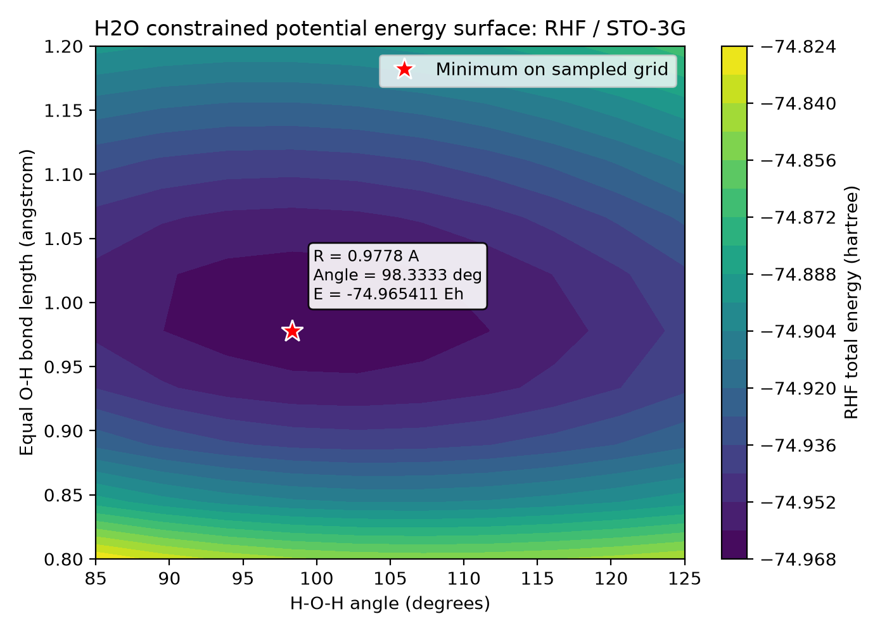
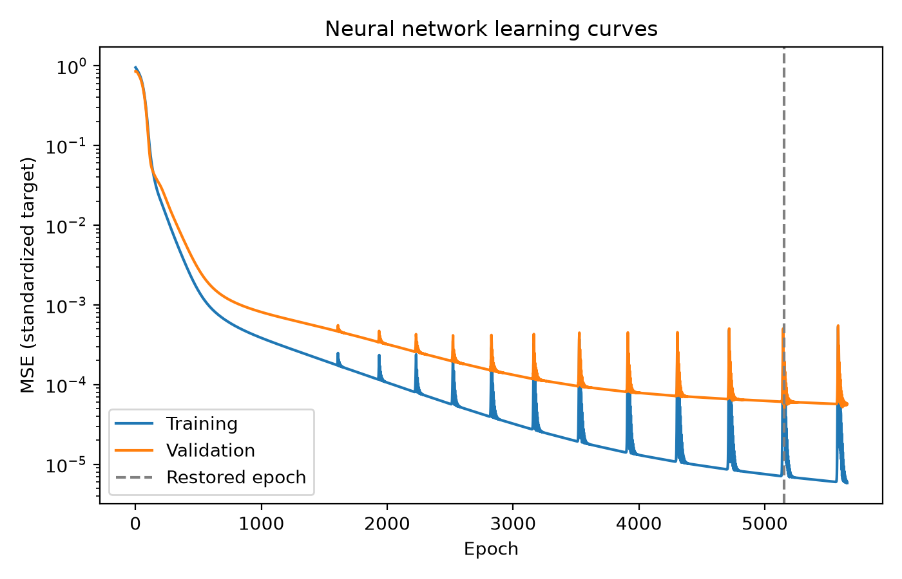
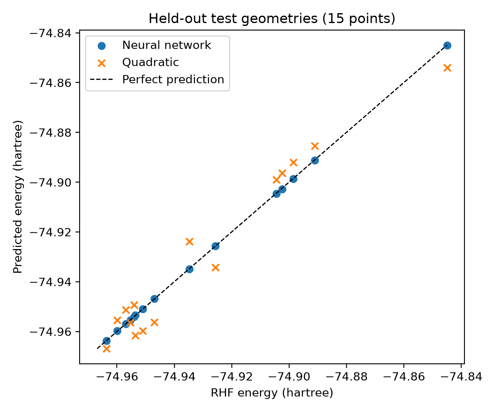

# Water potential energy surface — RHF/STO-3G

## Aim and geometry

This study samples a constrained two-dimensional potential energy surface of H₂O. The two O–H bond lengths are equal and vary from 0.8 to 1.2 Å (10 points). The H–O–H angle varies from 85 to 125 degrees (10 points), giving 100 geometries.

The oxygen is at the origin. The hydrogen coordinates in angstrom are `(R, 0, 0)` and `(R cos(theta), R sin(theta), 0)`, with `theta` converted from degrees to radians using `np.deg2rad`. Thus both O–H distances equal `R`, and all atoms lie in the xy plane.

## Method

PySCF calculates restricted Hartree–Fock (RHF) energies in the STO-3G basis for neutral water with `charge=0` and `spin=0`. Each energy includes nuclear repulsion, within the Born–Oppenheimer approximation.

`generate_data.py` follows four steps: build a geometry, converge RHF, store the total energy, then plot the surface after all 100 calculations succeed. The SCF energy tolerance is `1e-10` hartree, with at most 100 cycles. A failed or non-finite calculation stops the script with the bond length and angle; no values are invented or silently omitted. Calculation failures do not overwrite an earlier CSV, so check the run's exit status before using existing outputs.

## Run

From the repository root in Linux/WSL, reuse the existing environment. For installation, see the [main README](../README.md#installation-and-reproduction):

```bash
source .venv-wsl/bin/activate
python h2o/generate_data.py
```

The quantum calculation uses PySCF, NumPy and Matplotlib. The separate machine learning study below uses PyTorch and reads the existing CSV without running PySCF.

The script writes `h2o/water_energies.csv` with the columns `bond_length_angstrom`, `angle_deg` and `energy_hartree`, and saves the plot below. CSV rows are ordered first by increasing bond length, then by increasing angle. Energies in the figure are total energies in hartree; filled contours interpolate visually between the calculated grid points. The marked minimum is a sampled grid point, not a geometry optimization.

## Calculated results

All 100 RHF calculations converged in the existing WSL environment. The minimum on the sampled grid is:

| Equal O–H length (Å) | H–O–H angle (degrees) | Total energy (hartree) |
| --- | --- | --- |
| 0.97777778 | 98.33333333 | -74.965411283842 |

The surface shows an energy basin: compressing or stretching the bonds away from this region raises the energy, and bending changes the energy at each bond length. This is a grid minimum for the constrained RHF/STO-3G calculation, not an experimental geometry or a continuously optimized equilibrium structure.



## Limitations

STO-3G is a minimal basis and RHF does not include electronic correlation beyond Hartree–Fock. The energies and the location of the minimum therefore have limited quantitative accuracy. This surface is a constrained slice: independent changes in the two O–H lengths, including asymmetric stretching, are excluded. The finite range and coarse grid do not describe the full potential energy surface. Nuclear motion, zero-point energy and thermal effects are not included.

Any machine learning model trained on these data approximates this constrained RHF/STO-3G surface, rather than experimental energies or a correlated reference surface.

## Machine learning comparison

**Question:** Can a neural network accurately approximate the constrained potential energy surface of H₂O from a limited set of quantum chemistry calculations?

`train_model.py` reads the 100 existing RHF energies. Its inputs are the equal O–H length and H–O–H angle. A fixed random permutation (seed 42) gives 70 training, 15 validation and 15 test geometries. Both models share these splits. Missing values, data dimensions, duplicate geometries and split overlap are checked. Input and target means and standard deviations are computed from training data only; predictions are converted back to hartree before evaluation.

The neural network has layers 2 → 32 → 32 → 1 with Tanh activations in both hidden layers. It uses full-batch Adam (learning rate 0.001), MSE on the standardized target, CPU float64 and up to 10,000 epochs. Early stopping monitors validation MSE, with patience 500 and a minimum improvement of `1e-8`; the retained validation checkpoint is restored. Python, NumPy and PyTorch seeds are fixed, and deterministic PyTorch algorithms are enabled. Exact reproducibility across different software versions or platforms is not guaranteed.

The reference model is ordinary least-squares regression with the six terms `1, R, angle, R², R*angle, angle²`, formed from the standardized inputs. Degree 2 is fixed in advance. It is fitted only to the same 70 training points as the network. Test points are used only after both models are fitted; they do not select hyperparameters or the stopping epoch.

From the repository root in the existing WSL environment:

```bash
source .venv-wsl/bin/activate
python -m pip install -r h2o/requirements-ml.txt
python h2o/train_model.py
```

The script reports test MAE and RMSE in hartree and millihartree (1 mEh = 0.001 hartree). It also saves `ml_metrics.json` (splits, training statistics, settings and metrics), `test_predictions.csv` and `training_history.csv`. Row indices in the saved split are zero-based data-row indices, excluding the CSV header.

### Measured results

The CPU run used PyTorch 2.15.0+cpu and NumPy 2.5.4. Training stopped after 5,654 epochs and restored epoch 5,154 using validation loss.
An identical second run reproduced the saved test predictions and metrics exactly in this environment. Split isolation, training-only normalization statistics and metrics recomputed from the saved predictions were checked.

| Model | Test MAE (hartree) | Test RMSE (hartree) | MAE (mEh) | RMSE (mEh) |
| --- | --- | --- | --- | --- |
| Neural network | 0.0001361662 | 0.0001580903 | 0.136166 | 0.158090 |
| Degree-2 polynomial | 0.0064826161 | 0.0069594570 | 6.482616 | 6.959457 |

For this fixed split, the network approximates the held-out RHF energies more accurately than the quadratic model. A quadratic captures only a second-order shape over the whole sampled range, whereas the network can represent a more flexible surface. This result does not establish that neural networks outperform all classical approximations.





This is a small, single-split comparison with only 15 test points, so its errors are uncertain. Randomly held-out points assess prediction on the same sampled domain, not reliable extrapolation beyond it. The study does not validate forces, molecular dynamics or performance on other molecules. Predicting the RHF energies accurately would not remove their underlying quantum-chemical limitations.

Reproducibility settings follow the [PyTorch documentation](https://docs.pytorch.org/docs/stable/notes/randomness.html).
